  

  
  
  

---

## About Me

I'm a **Computer Science student at Cégep Marie-Victorin** in Montréal, interested in **networking, systems, and backend development**. I like building projects that show me how software and infrastructure work end to end, from the network layer up to the API.

### What I'm working on

- 🌐 Designing and simulating networks in **Cisco Packet Tracer** (VLSM, static routing, NAT)
- ⚔️ Building a **turn-based RPG REST API in Java**
- 🔌 Embedded projects with **MicroPython** on ESP32, Arduino and Raspberry Pi
- 📚 Coursework in networking, security, operating systems, software architecture and data structures
- 💼 Looking for an **internship starting Summer 2027**

---

## Tech Stack

  

| Area | Technologies |
|---|---|
| **Languages** | Python · Java · JavaScript · TypeScript · SQL |
| **Networking** | Network design · VLSM & subnetting · Static routing · NAT · Cisco Packet Tracer |
| **Systems** | Linux · Bash · VMware |
| **Web** | React · Vite · FastAPI · HTML · CSS |
| **Databases & Tools** | MySQL · Git · GitHub |
| **Embedded** | MicroPython · ESP32 · Arduino · Raspberry Pi |

---

## Featured Projects

| Project | Description | Stack |
|---|---|---|
| [**Esp-32-Radio**](https://github.com/Fckmads07/Esp-32-Radio) *(in progress)* | **ChronoAlarme**: standalone stopwatch, timer and alarm clock with a 16x2 I2C LCD and I2S audio output | MicroPython · ESP32 |
| [**portfolio**](https://github.com/Fckmads07/portfolio) | My personal portfolio site, with a design inspired by Parrot OS: typing hero, terminal, projects and experience pages | React · TypeScript · Vite |
| [**CryptoTrack**](https://github.com/Fckmads07/CryptoTrack) · [live](https://crypto-track-ljis.vercel.app) | Browse, search and favorite cryptocurrencies, powered by my own FastAPI REST API | React · Vite · Python · FastAPI |
| [**Timer**](https://github.com/Fckmads07/Timer) | Clock, stopwatch, countdown and Pomodoro web app with world clocks, alarms and animated backgrounds | HTML · CSS · JavaScript |
| [**Programmation-De-Plateforme**](https://github.com/Fckmads07/Programmation-De-Plateforme) | Embedded programming labs: GPIO, PWM, ADC and I2C peripherals on an ESP32 | MicroPython · ESP32 |
| [**Meme_generator**](https://github.com/Fckmads07/Meme_generator) | Meme generator using the Imgflip API, with custom top and bottom captions | React · Vite |
| **RPG REST API** *(in progress)* | Turn-based RPG game engine exposed as a REST API | Java |

---

## GitHub Activity

  
  

  

---

## Languages

🇫🇷 French · 🇬🇧 English

## Contact

The best way to reach me is on **[LinkedIn](https://www.linkedin.com/in/madhav-ramdin-241a06377/)**.
